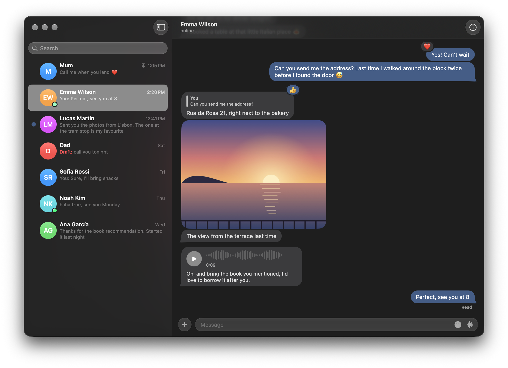

# Hushh

A calm macOS client for Telegram: your friends' chats, without stories, channels or noise.
Unofficial client using the Telegram API, built on [TDLib](https://github.com/tdlib/td) through
[TDLibKit](https://github.com/Swiftgram/TDLibKit).

Hushh needs macOS 26 (Tahoe) or later. You build it yourself, with your own Telegram API
credentials ([Set up](#set-up)).

Made-up chats, from Hushh's demo mode (`scripts/demo.sh`).

| Chat | Shown? |
|---|---|
| People, Saved Messages | Yes, unless you hide one |
| Groups, channels, bots, Telegram's service chat | Only the ones you pick |
| "X joined Telegram" chats | Not until someone actually writes |

Picked channels are read-only unless you're an admin, and large public ones show Telegram's
sponsored messages below the last post: Telegram's API terms require clients that show channels to
include them.

Calls and secret chats stay on your phone: this Mac's session tells Telegram it can't accept them.

## Set up

1. Install Xcode 26 from the App Store, then run `sudo xcode-select -s /Applications/Xcode.app`.
   The Command Line Tools alone are not enough, also for `swift build`: HushUI uses SwiftUI
   macros, which only Xcode includes.
2. Install XcodeGen: `brew install xcodegen`.
3. Get an API ID and hash at [my.telegram.org](https://my.telegram.org) → API development tools.
   The app title there must not contain the word "Telegram".
4. Copy `Config/Secrets.example.xcconfig` to `Config/Secrets.xcconfig` and fill it in:
   `HUSH_API_ID` is the digits of the API ID, `HUSH_API_HASH` the 32 hexadecimal characters of
   the hash, with no quotes or spaces.
   Adding your Apple ID's Personal Team there stops keychain prompts after each rebuild. A team
   is optional: builds use the hardened runtime with or without one.
   The build copies the API ID and hash into Hushh.app, so do not give your build to other people.
5. Run `xcodegen generate && open Hush.xcodeproj`, then press Run. The scheme, the bundle ID
   (`com.macneil.Hush`) and the data folders keep the name Hush; the scheme builds Hushh.app.
   To install a Release build as `/Applications/Hushh.app` instead, quit Hushh and run
   `scripts/install.sh`.

## Keyboard

| Keys | Action |
|---|---|
| ⌘K | Switch to a chat by name |
| ⌘1 – ⌘9 | The first nine chats in your list |
| ⌥⌘↑ / ⌥⌘↓ | Previous / next chat |
| ⇧⌘A | Archived chats |
| ⌘F | Find in the open chat |
| ⌘I | Show or hide the open chat's info |
| ⌘R | Record a voice message; press again to send it |
| ⌘, | Settings |

To choose which groups, channels and bots to show, open Settings → Chats.

In the message box:

| Keys | Action |
|---|---|
| Enter | Send |
| Shift+Enter, ⌃Enter | New line |
| ↑ | Edit your last message (box empty) |
| Tab, ⇧Tab | Next or previous control |
| ⌥Tab | Type a tab |
| Esc | Close the sticker picker, or cancel the recording, edit, reply or attachments, in that order; with nothing to cancel and the box empty, close the chat |

While you record, Enter sends the text in the box, not the recording: send the recording with
its button or ⌘R. The first time you record, macOS asks for the microphone; after you allow it,
press Record again.

Text is sent with Markdown formatting: `**bold**`, `__italic__`, `~~strikethrough~~`,
`||spoiler||`, `` `code` `` and `[text](URL)`. A backslash does not escape these characters.

## Drag and drop

- Drag files onto a conversation: drop on the top half to send them as files (original quality),
  on the bottom half to send pictures and videos compressed, shown right in the chat.
- Drop files on a chat in the sidebar to open it with them attached, or hover there a moment to
  switch to it first.
- Drag a photo, video or file out of a chat into Finder or another app for a copy.

## Transcription and search

- **Transcription**: the text button on a voice message or circle asks Telegram to transcribe it,
  as its own apps do; the text appears as Telegram works through it. Telegram does this on its
  servers, with Premium or a few free transcriptions a week.
- **Find in Chat (⌘F)**: Telegram's word search across the whole history, plus search by meaning
  that runs on this Mac with
  [multilingual-e5-small](https://huggingface.co/intfloat/multilingual-e5-small) through
  [swift-embeddings](https://github.com/jkrukowski/swift-embeddings). Settings → AI downloads the
  model once (490 MB); search by meaning does not send messages anywhere. Each chat is indexed in
  the background the first time you search it (newest first, up to 10,000 messages, a page at a
  time with a short pause between pages), then kept current. ↑/↓ choose a result, Enter jumps to
  it, ⓧ clears the field, Esc or Done closes the search.
- **Search by meaning** shows at most three messages, and only close matches, so it can show
  none. A query with only short or very common words, such as "the", uses word search only.

Search indexes are kept per account under `accounts/<id>/ai/`, encrypted with a key derived from
the database key in the keychain. That key also encrypts TDLib's database, which holds your
messages and their transcripts. Downloaded photos, videos, voice messages and files are not
encrypted: they are plain files in `tdlib/files`. The model lives in
`Application Support/Hush/Models`.

Logging out deletes this Mac's copy of the account: TDLib's database and downloaded files, the
search indexes, the list of chats you hid, and the database key. The search model stays.

## Develop

- All code lives in `Packages/HushCore`:
  - `HushCore`: the TDLib session, login, and the chat filter (`VisibilityPolicy`).
  - `HushUI`: the SwiftUI views.
  - `HushAI`: search by meaning (the model, its download and the search indexes).
  - The Xcode app target only contains `App/HushApp.swift`.
- `project.yml` defines the Xcode project. After editing it, run `xcodegen generate`. `Hush.xcodeproj`, `App/Info.plist` and `App/Hush.entitlements` are generated.
- To build and test without the app, run `cd Packages/HushCore && swift build && swift test`.
  This needs Xcode too. To use Xcode without changing `xcode-select`, first run
  `export DEVELOPER_DIR=/Applications/Xcode.app/Contents/Developer`.
- `swift run hush-smoke` checks that TDLib loads on this Mac. It needs no credentials.
- `swift scripts/make-icon.swift` redraws the app icon.
- `scripts/demo.sh [--dark|--light] [path/to/Hushh.app]` opens Hushh with made-up chats, for screenshots: it does not log in to
  Telegram. Without a path it uses `/Applications/Hushh.app`, or else a build from `scripts/install.sh --build-only` or Xcode.
  Press ⌘⇧4, Space and click the window to capture it.
- `scripts/install.sh --build-only` makes a Release build in `build/DerivedData` without installing it.
- `HUSH_MODEL_TESTS=1 swift test --filter ModelTests` runs search by meaning with the real model
  (downloads about 490 MB into `~/Library/Caches/HushModelTests` the first time).
- `HUSH_PREVIEW_DIR=/tmp/hushh-preview swift test --filter DesignPreviewTests` draws a made-up
  conversation and sidebar with the real views, in light and dark mode, as PNGs.
- TDLib's log (errors only) is written to `~/Library/Containers/com.macneil.Hush/Data/Library/Application Support/Hush/tdlib/tdlib.log`.

## Updating TDLib

Telegram rejects TDLib versions that are too old: logging in then fails with `UPDATE_APP_TO_LOGIN`.
Bump TDLib every couple of months:

1. In `Packages/HushCore/Package.swift`, bump both pins together. TDLibKit's tag looks like `1.5.2-tdlib-1.8.67-42e6a525`, and TDLibFramework's matching tag is `1.8.67-42e6a525`.
2. Run `swift build`.
3. Fix any new `AuthorizationState` cases the compiler reports.

## License

MIT, see [LICENSE](LICENSE). Hushh includes these packages, each under its own licence:

- [TDLib](https://github.com/tdlib/td) (Boost Software License)
- [TDLibKit](https://github.com/Swiftgram/TDLibKit) and [TDLibFramework](https://github.com/Swiftgram/TDLibFramework) (MIT);
  TDLibFramework's build of TDLib includes [OpenSSL](https://www.openssl.org) (Apache 2.0)
- [Lottie](https://github.com/airbnb/lottie-spm) (Apache 2.0)
- [swift-embeddings](https://github.com/jkrukowski/swift-embeddings), [swift-safetensors](https://github.com/jkrukowski/swift-safetensors) and [swift-sentencepiece](https://github.com/jkrukowski/swift-sentencepiece) (MIT);
  swift-sentencepiece includes a build of [SentencePiece](https://github.com/google/sentencepiece) (Apache 2.0), with Protocol Buffers (BSD 3-Clause)
- [swift-transformers](https://github.com/huggingface/swift-transformers), [swift-huggingface](https://github.com/huggingface/swift-huggingface) and [swift-jinja](https://github.com/huggingface/swift-jinja) (Apache 2.0)
- [swift-crypto](https://github.com/apple/swift-crypto) and [swift-collections](https://github.com/apple/swift-collections) (Apache 2.0)
- [yyjson](https://github.com/ibireme/yyjson) and [EventSource](https://github.com/mattt/EventSource) (MIT)

The search model it can download, multilingual-e5-small, is MIT-licensed.
